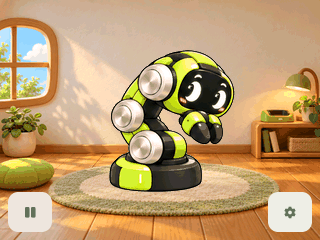
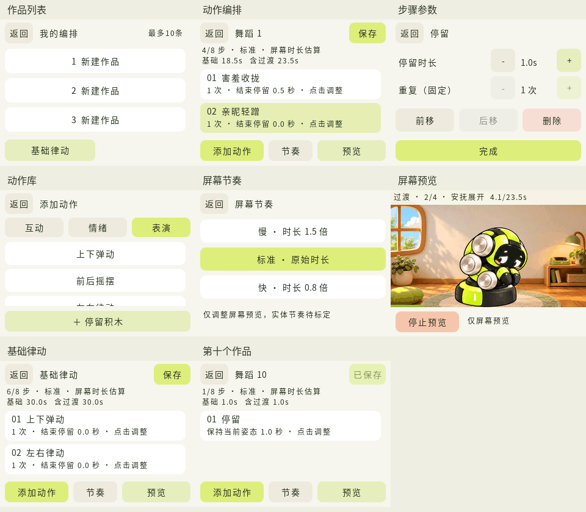

# reBuddy

> 住在屏幕里的 reBot RS 机械臂桌宠 —— 触摸互动小屋、日常表情与屏幕编舞，基于 ESP32-C5 与 LVGL。

[](https://github.com/Eaglewzw/reBuddy/actions/workflows/host-tests.yml)
[](https://github.com/Eaglewzw/reBuddy/actions/workflows/firmware-build.yml)
[](https://docs.espressif.com/projects/esp-idf/)
[](https://lvgl.io/)
[](https://www.seeedstudio.com/)
[](LICENSE)

reBuddy 是一只住在 320×240 小屋里的机械臂桌宠：小窗、木地板、地毯与充电角。它通过触摸、表情和身体动画回应你；独立编舞页可以排列动作、调整节奏，保存自己的屏幕小表演。

| 主界面 | 编舞编辑器 |
|:---:|:---:|
|  |  |

## ✨ 功能特性

**触摸互动**

- 轻点角色小幅抬头注视；缓慢抚摸身体轻蹭；快速划动疑惑歪头、头顶浮出三个问号。
- 连续轻点仍为探头回应，最多保留一个待处理请求。
- 轻柔来回抚摸手爪，累计约 0.6 秒有效移动即可请求开心回应；若正在轻蹭，会先平滑结束当前动作。静止长按和摸头不累计开心（[触摸区域示意](assets/images/previews/claw-petting-guide.svg)）。
- 无操作 60 秒后入睡，或从设置选择休息。呼吸与飘起、淡出的 Z 持续循环，点击左下角旋转箭头唤醒。

**屏幕编舞**

- 从右下角设置进入独立编排页：动作只能从十组基础舞蹈中选择，支持重复、调整顺序与节奏，以及保持画面的停留积木；每个作品最多 8 步，保存最多 10 个作品。
- 每次播放自动加入开场和收尾，不占手动步骤；停止后保持当前画面。编排不使用日常互动动作，也不自动插入日常过渡。
- 编辑和预览不会触发日常手势或电机动作，退出后恢复日常状态。详见[编舞说明](assets/docs/CHOREOGRAPHY.md)。

**小屋日常**

- 暂停／恢复入口固定在左下角，设置固定在右下角；可切换活泼／慵懒，再次点击齿轮或面板外区域即可关闭。

## 🧩 硬件

| 项目 | 规格 |
| --- | --- |
| 主控 | XIAO ESP32-C5 CAN Console |
| 屏幕 | 320×240 ST7789 |
| 触摸 | GT911 |
| Flash / PSRAM | 8 MiB / 8 MiB Quad |
| 机械臂 | reBot Arm B601-RS：六关节 + 夹爪开合，CAN 总线 |

- 开发板实体 ENTER 已接为 HOME 回零；GPIO 急停输入尚未接入。
- 本地 CAN、电机与轨迹组件已接入，默认构建开启 daily 联动；显式关闭联动后为只收不发的监听模式。
- 联动构建上电显示 SLEEP 且不使能电机；点击左下角旋转箭头后使能并执行 WAKE 回到待机。

## 🚀 快速开始

环境：ESP-IDF 5.5.6、LVGL 9.5.0。公开组件版本由 `dependencies.lock` 锁定，首次构建需要下载。

```bash
# 构建固件
source /path/to/esp-idf/export.sh
idf.py -B build build

# 烧录并监视（替换成实际串口）
idf.py -B build -p /dev/ttyACM0 flash monitor
```

```bash
# 主机端行为 / 触摸 / 资源 / UI 测试，无需硬件
cmake -S tests/host -B build/host
cmake --build build/host -j8
ctest --test-dir build/host --output-on-failure
```

PC 端舞蹈库试播：`./tools/dance --list` 查看 10 组动作及开场/收尾，`./tools/dance --supported` 进入实机终端。

## 📖 文档

| 文档 | 内容 |
| --- | --- |
| [运行与开发指南](assets/docs/GETTING_STARTED.md) | 环境搭建、构建、烧录与开发流程 |
| [编舞说明](assets/docs/CHOREOGRAPHY.md) | 编排页操作、节奏与保存 |
| [日常动作说明](assets/docs/DAILY_COMMANDS.md) | 动作对应表、速度及验证范围 |
| [舞蹈库](assets/docs/DANCE_LIBRARY.md) | 十组基础舞蹈与开场收尾 |
| [舞蹈优化与空间预算](assets/docs/DANCE_OPTIMIZATION.md) | 动画资源上限与过渡计算接口 |
| [GIF 分类](assets/gifs/README.md) | 日常、舞蹈与预览动画 |
| [测试说明](assets/docs/TESTING.md) | 主机测试与验收标准 |
| [素材来源和状态](assets/README.md) | 资源索引与制作说明 |
| [第三方许可](assets/docs/THIRD_PARTY_NOTICES.md) | 图片、字体和依赖来源 |

## 📁 工程结构

| 目录 | 内容 |
| --- | --- |
| `main/` | [应用模块](main/README.md)：入口、界面、存储、动画和生成代码 |
| `components/` | 触摸行为、编舞序列核心与独立板级驱动 |
| `tools/` | [命令入口与模块](tools/README.md)：录制、播放、配置生成、资源导出和打包 |
| `record/` | [动作数据索引](record/README.md)：原始录制、姿态预设和已处理轨迹 |
| `tests/host/` | 行为、触摸、资源与 LVGL 主机测试 |
| `assets/` | 文档、图片、GIF、设计源图、配置、字体许可与验证结果，详见[资源索引](assets/README.md) |
| `build/`、`build/host/` | ESP-IDF 与主机构建产物，不纳入 Git；诊断日志应单独保留 |
| `dist/` | 本地生成的烧录包，不纳入 Git |

公开依赖 `managed_components/` 和本机构建目录不需要上传；上传源码时使用 Git 中的文件即可。

## 📌 项目状态

**已完成**

- 屏幕桌宠日常互动与睡眠循环：触摸手势、表情与动作播放由主机回归测试覆盖。
- 独立编舞编辑器、屏幕预览与 NVS 双记录保存。
- 十组基础舞蹈屏幕库：统一中立首尾，自动开场收尾各四拍（100 BPM 时 2.4 秒），停留按半拍调整；共享 64 色、离线轮廓遮罩与有限深度差分，九个高帧率基础动作标准节奏目标 20 FPS。原始 GIF 保留。
- 八项日常动作导出为 C5 轨迹数据，并绑定 daily GIF 与屏幕播放时序。
- GitHub Actions：主机测试与固件构建工作流。

**进行中 / 待实机验收**

- 原生 CAN 执行已接入，尚未烧录或完成 C5 实机验收；连续 30 分钟交互及实际屏幕帧率需上板验收。
- 底盘回转仍受 16 个原始转身姿态限制，已增加首尾连接，不能宣称与其他动作同样流畅。
- 十组基础舞蹈已有 PC 端轨迹，尚未接入板端实体编舞；Dance 机械臂轨迹仍由 PC 播放。
- 活泼与慵懒暂使用相同日常播放速度。

**计划**

- GPIO 急停输入接入。
- 板端实体编舞的 CAN 同步执行。
- 已加入的通用关键帧与受关节速度／加速度约束的过渡计算接口，在实体编排中落地。

> 动画资源上限为 5 MiB，构建强制为后续机械臂数据、代码增长及余量预留至少 2 MiB。固件使用 8 个日常 GIF（平均 8 FPS）与 10 个舞蹈及开场收尾素材转换的 RGB565 动画。

## 📄 许可证

代码采用 [Apache-2.0](LICENSE)。图片、字体和依赖来源见 [THIRD_PARTY_NOTICES.md](assets/docs/THIRD_PARTY_NOTICES.md)。
