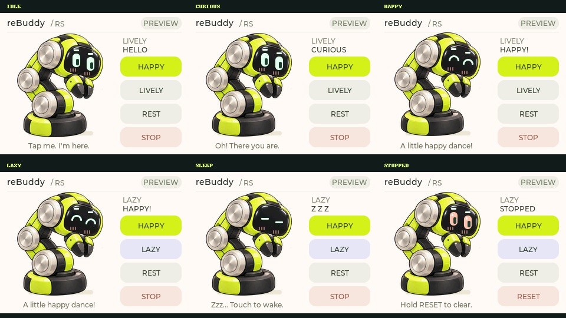

# reBuddy

**摸摸屏幕里的小家伙，让机械臂成为你的桌面伙伴。**

reBuddy 是一个基于 **ESP32-C5、触摸屏和 reBot RS 机械臂** 的开源桌宠项目。屏幕里的角色负责表情，机械臂负责身体动作：探头回应你的招呼，被抚摸时轻轻蹭蹭，困了就蜷下来打个盹。

**板级适配随项目源码提供，可独立构建。** 屏幕、触摸、IO 扩展和按键支持均包含在仓库中，软件依赖全部来自公开的 ESP-IDF、LVGL 和 Espressif 组件。

项目以直接触摸角色为主要交互方式，希望把触摸输入、表情和实体动作串成一次自然的互动，让机械臂有一点可爱、有一点性格，也有值得反复探索的小反应。

## 和它相处

| 你的互动 | 桌宠的回应 |
| --- | --- |
| 轻点角色 | 探头看你，回应招呼 |
| 在角色上缓慢抚摸 | 放松表情，舒服地蹭蹭 |
| 连续点击角色 | 害羞地缩回去 |
| 在角色上快速来回划动 | 歪头，露出疑惑的表情 |
| 一段时间没有互动 | 渐渐困倦，打瞌睡后进入休息 |
| 休息时触摸角色 | 醒来，重新陪你玩 |

“蹭蹭”通过小幅姿态变化表达亲近，无需机械臂接触人。动作库还包含开心小舞蹈，和探头、蹭蹭、害羞、歪头、打瞌睡一起组成六种基础动作。

同一个角色有两种行为风格：**活泼**时反应轻快、表达更明显；**慵懒**时动作舒缓、幅度更小。两种风格共用动作库，让性格体现在节奏和姿态里。

## 界面预览



角色采用黄绿色外壳、银色关节和前置夹爪，呼应 reBot RS 的机械臂形态。眼睛、眉毛和腮红由 LVGL 实时绘制，用于表现不同情绪。

上图为当前开发版界面。角色区域已支持触摸手势，右侧仍保留动作与设置按钮；开心小舞蹈目前通过 `HAPPY` 按钮或实体按键触发。后续界面将进一步突出直接触摸角色的体验。

## 当前阶段

项目处于**屏幕互动原型阶段**：已实现角色表情、触摸识别、两种行为风格、休息与唤醒，以及六个动作的关键帧配置和调度。

**实体机械臂适配与姿态标定尚未完成。** 当前固件运行在 `PREVIEW` 模式，不使能电机、不发送 RS 运动命令。上述身体动作是项目的目标体验，当前可预览表情和动作时间轴；实机触摸与连续互动测试仍待验证。

接下来将完成机械臂接入、低速动作调试和表情同步。在核心体验稳定后，再考虑屏幕动作编舞及其他机械臂适配。

## 硬件与实现

- **主控：** ESP32-C5，负责显示、触摸、行为状态和动作调度。
- **屏幕：** 当前适配 320 × 240 横屏，ST7789 显示与 GT911 触摸。
- **机械臂：** 面向 reBot RS，六轴机械臂加夹爪，预留控制适配接口。
- **软件：** ESP-IDF 5.5.5、LVGL 9.5；独立 C 行为核心，使用关键姿态、平滑插值和表情时间轴组织互动。

当前固件面向带 8 MiB Flash、8 MiB PSRAM 的 XIAO ESP32-C5 CAN Console。详细接线与板卡要求见[硬件说明](docs/HARDWARE.md)。

## 快速开始

**构建 ESP32-C5 屏幕固件**

安装 ESP-IDF 5.5.5 及 ESP32-C5 工具链后执行以下命令。将 SDK 路径替换为实际安装位置；首次构建会自动下载公开组件，无需克隆其他应用仓库。

```bash
git clone https://github.com/Eaglewzw/reBuddy.git
cd reBuddy
source /path/to/esp-idf-v5.5.5/export.sh
idf.py -B build-c5 build
```

固件输出为 `build-c5/reBuddy.bin`。当前为屏幕预览版本，尚不驱动实体机械臂。接线、烧录和旧版本升级步骤见[开发指南](docs/GETTING_STARTED.md)。

**在电脑上运行测试**

无需开发板或 ESP-IDF。准备 CMake、Ninja、C/C++ 编译器和 Python 3，在项目根目录执行：

```bash
cmake -S tests/host -B build-host -G Ninja
cmake --build build-host
ctest --test-dir build-host --output-on-failure
```

界面测试与截图生成见[测试说明](docs/TESTING.md)。

## 参与开发

角色与交互在 [`main/pet_ui.c`](main/pet_ui.c)，行为与手势在 [`components/rebuddy_core/`](components/rebuddy_core/)，六个动作的配置在 [`config/actions.json`](config/actions.json)。欢迎围绕角色表现、触摸体验、动作设计和硬件适配提交 Issue 或 Pull Request。

- [动作设计与机械臂接入](docs/MOTION.md)
- [开发路线](docs/ROADMAP.md)
- [体验与稳定性验收](docs/ACCEPTANCE.md)

## 许可证

本项目代码采用 [Apache-2.0](LICENSE) 许可证。第三方组件和角色素材的来源见[第三方说明](THIRD_PARTY_NOTICES.md)。
