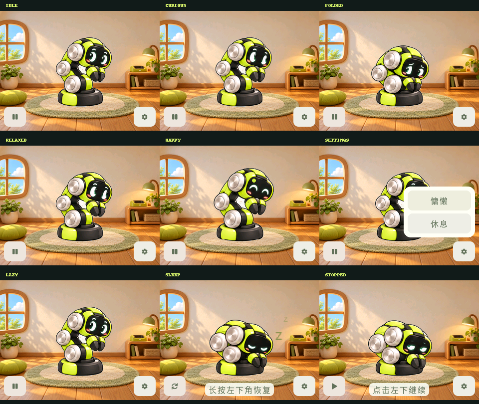

# reBuddy

基于 ESP32-C5 的 reBot RS 屏幕桌宠。它住在带小窗、木地板、地毯与充电角的小屋里，通过触摸、表情和身体动画回应你。



## 互动方式

- 轻点角色小幅抬头注视，缓慢抚摸身体轻蹭，快速划动疑惑歪头、头顶浮出三个问号。
- 1.2 秒内轻点三次让它收拢；温柔抚摸后安抚展开。
- 只有抚摸眼睛上方的头顶才累计开心：6 秒内累计 3 秒有效摸头，静止长按不计时。[触摸区域](docs/preview/head-petting-guide.png)
- 无操作 60 秒后入睡，或从设置选择休息。呼吸与逐渐缩小的 Z 持续循环，长按左下角唤醒。
- 暂停／恢复入口固定在左下角，设置固定在右下角。设置可切换活泼／慵懒；再次点击齿轮或面板外区域即可关闭。

[独立 GIF 文件夹](assets/gifs/) · [运行与开发指南](docs/GETTING_STARTED.md) · [素材来源和状态](docs/ASSET_STATUS.md)

## 硬件与范围

目标为 XIAO ESP32-C5 CAN Console：320×240 ST7789、GT911 触摸、8 MiB Flash 和 8 MiB Quad PSRAM。板级驱动随工程提供，没有私人仓库依赖。当前仅使用触摸屏，不配置实体按键或 GPIO 急停输入，CAN 保持待机，无电机后端和编舞功能。

当前动画包含 28 张关键姿态，表情已绘制在角色图中。细腻的中间帧、连续跟眼与部分衔接仍待完善；主机测试不能代替实机视觉和连续 30 分钟体验验收。

## 开发

环境：ESP-IDF 5.5.6、LVGL 9.5.0。公开组件版本由 `dependencies.lock` 锁定，首次构建需要下载。

```bash
source /path/to/esp-idf/export.sh
idf.py -B build build
# 需要烧录时执行，替换成实际串口：
idf.py -B build -p /dev/ttyACM0 flash monitor
```

```bash
cmake -S tests/host -B build-host
cmake --build build-host -j8
ctest --test-dir build-host --output-on-failure
```

## 工程结构

| 目录 | 内容 |
| --- | --- |
| `main/` | LVGL 小屋界面、动画播放器与资源缓存 |
| `components/` | 当前触摸行为核心与独立板级驱动 |
| `assets/animation/` | 固件 RGB565 资源和清单 |
| `assets/gifs/` | 当前小屋版 10 个独立动作 GIF、说明与校验值 |
| `assets/design/` | 当前素材源图、生成提示词及动作设计草案 |
| `assets/reference/`、`assets/approved/` | 原始参考与用户选定素材 |
| `config/` | 行为参数、头部触摸区域与动作分镜设计 |
| `docs/` | 开发、硬件、动画设计与验收说明 |
| `tools/`、`tests/host/` | 配置生成、资源导出、打包与测试 |

代码采用 [Apache-2.0](LICENSE)。图片、字体和依赖来源见 [THIRD_PARTY_NOTICES.md](THIRD_PARTY_NOTICES.md)。
