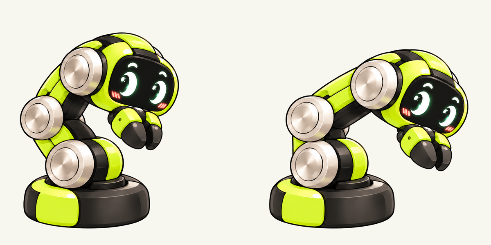

# reBuddy

基于 XIAO ESP32-C5 CAN Console 的 reBot RS 屏幕桌宠。当前重点是角色动画与动作表现，暂不开展机械臂控制和编舞。

## 当前保留版本：探头 v2

用户已选择保留这版待机 / 探头姿态及往返 GIF，后续动画沿用它作为探头视觉基线。



- [600×600 GIF](docs/preview/probe-v2/probe-v2-poses.gif) · [160×160 GIF](docs/preview/probe-v2/probe-v2-poses-160.gif)
- [选定原图](assets/approved/probe-v2/source.png) · [素材状态与目录说明](docs/ASSET_STATUS.md)

目前是两个关键姿态，每个停留700ms，没有连续中间帧，尚未接入固件。现有固件仍使用旧的74帧技术原型，保留它仅为维持行为/显示开发和可构建性。

## 工程目录

| 目录 | 用途 |
| --- | --- |
| `assets/approved/` | 用户选择保留的原始素材、来源与校验清单 |
| `assets/reference/` | 两张原始角色/互动参考图，原样保留 |
| `assets/animation/` | 现有固件仍依赖的旧RGB565帧、清单和色条 |
| `docs/preview/probe-v2/` | 选定版本的对齐姿态、对照图及两种尺寸GIF |
| `main/` | 当前UI、动画播放器、帧缓存及应用入口 |
| `components/` | 行为核心及板级驱动；旧模块保留供回归 |
| `config/` | 当前触摸参数与旧动作配置 |
| `tests/host/` | 行为、资源、板级输入和LVGL测试 |
| `tools/` | [素材生成、预览与打包工具](tools/README.md) |
| `docs/reference/` / `docs/verification/` | 原始需求正文 / 最新技术验证记录 |
| `build/` / `managed_components/` | 本机构建缓存 / 依赖，不作为素材交付目录 |

旧探头12帧试稿、临时裁切图、旧界面截图、未使用的生成角色和旧固件分发包已清理。下载目录中的原始文件未改动。

## 开发入口

- [当前素材状态](docs/ASSET_STATUS.md) · [动画视觉要求](docs/ANIMATION_FIDELITY.md)
- [网页端制作提示词](docs/WEB_ANIMATION_ASSET_BRIEF.md) · [后续顺序](docs/ROADMAP.md)
- [构建与操作](docs/GETTING_STARTED.md) · [测试](docs/TESTING.md) · [验收](docs/ACCEPTANCE.md)
- [硬件](docs/HARDWARE.md) · [显示统计](docs/DISPLAY_PERFORMANCE.md)
- [旧技术原型实现记录](docs/REFERENCE_IMPLEMENTATION.md)

## 构建与预览

固件基线为ESP-IDF 5.5.5、LVGL 9.5.0，板级实现随工程提供。

```bash
source /path/to/esp-idf-v5.5.5/export.sh
idf.py -B build build
cmake -S tests/host -B build-host
cmake --build build-host -j8
ctest --test-dir build-host --output-on-failure
```

重新生成选定版本的GIF（需要Pillow，不修改固件资源）：

```bash
python3 tools/render_approved_probe.py
```

旧UI诊断截图请输出到 `build/ui-preview/`，避免与已选定的动画素材混放。当前CAN保持待机，未烧录本轮整理结果。

代码采用 [Apache-2.0](LICENSE)，素材来源见 [THIRD_PARTY_NOTICES.md](THIRD_PARTY_NOTICES.md)。
