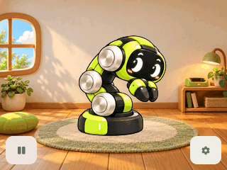

# reBuddy

基于 ESP32-C5 的 reBot RS 屏幕桌宠。它住在带小窗、木地板、地毯与充电角的小屋里，通过触摸、表情和身体动画回应你。独立编舞页还可以排列动作、调整节奏，保存自己的屏幕小表演。



## 互动方式

- 轻点角色小幅抬头注视，缓慢抚摸身体轻蹭，快速划动疑惑歪头、头顶浮出三个问号。
- 1.2 秒内轻点三次让它收拢；温柔抚摸后安抚展开。
- 轻柔来回抚摸手爪，累计约 0.6 秒有效移动即可请求开心回应；若正在轻蹭，会先平滑结束当前动作。静止长按和摸头不累计开心。[触摸区域](assets/images/previews/claw-petting-guide.svg)
- 无操作 60 秒后入睡，或从设置选择休息。呼吸与飘起、淡出的 Z 持续循环，长按左下角唤醒。
- 暂停／恢复入口固定在左下角，设置固定在右下角。设置可切换活泼／慵懒；再次点击齿轮或面板外区域即可关闭。

[全部 GIF 分类](assets/gifs/README.md) · [编舞操作](assets/docs/CHOREOGRAPHY.md) · [运行与开发指南](assets/docs/GETTING_STARTED.md) · [素材来源和状态](assets/README.md)

## 编舞

从右下角设置中的“编排”进入独立页面。动作只能从用户选定的十组舞蹈中选择，支持重复、调整顺序与节奏，以及保持画面的停留积木。每个作品最多 8 步，保存最多 10 个作品。

舞蹈在原有小屋背景中播放，每次播放自动加入开场和收尾，不占手动步骤；停止后保持当前画面。编排不使用日常互动动作，也不自动插入日常过渡。编辑和预览不会触发日常手势或电机动作，退出后恢复日常状态。

## 硬件与范围

目标为 XIAO ESP32-C5 CAN Console：320×240 ST7789、GT911 触摸、8 MiB Flash 和 8 MiB Quad PSRAM。板级驱动随工程提供，没有私人仓库依赖。当前仅使用触摸屏，不配置实体按键或 GPIO 急停输入，已接入本地 CAN、电机与轨迹组件，默认 CAN 保持待机；可选只收不发的监听模式，尚未开放实体动作执行。编舞当前提供屏幕编辑、预览与保存。后续机械臂联动以标准 reBot Arm B601-RS 为目标，当前没有经标定的电机轨迹。

固件使用 10 个日常 GIF、10 个舞蹈及开场收尾素材转换的 RGB565 动画。日常保留平均 8 FPS；舞蹈运行资源使用共享 64 色、离线轮廓遮罩和有限深度差分，九个高帧率基础动作在标准节奏下目标 20 FPS。十组动作统一中立首尾，基础动作和自动开场收尾各四拍（100 BPM 时 2.4 秒），停留按半拍调整。底盘回转仍受 16 个原始转身姿态限制，增加了首尾连接，不能宣称与其他动作同样流畅。原始 GIF 保留。

动画资源约 5.06 MB，构建强制为后续机械臂数据、代码增长及余量预留至少 2 MiB。已加入通用关键帧和受关节速度／加速度约束的过渡计算接口，尚无已标定电机轨迹。详见 [舞蹈优化与空间预算](assets/docs/DANCE_OPTIMIZATION.md)。活泼与慵懒仍使用相同日常播放速度；连续 30 分钟及实际屏幕帧率需上板验收。

## 开发

环境：ESP-IDF 5.5.6、LVGL 9.5.0。公开组件版本由 `dependencies.lock` 锁定，首次构建需要下载。

```bash
source /path/to/esp-idf/export.sh
idf.py -B build/firmware build
# 需要烧录时执行，替换成实际串口：
idf.py -B build/firmware -p /dev/ttyACM0 flash monitor
```

```bash
cmake -S tests/host -B build/host
cmake --build build/host -j8
ctest --test-dir build/host --output-on-failure
```

## 工程结构

| 目录 | 内容 |
| --- | --- |
| `main/` | LVGL 小屋与编舞界面、作品存储、动画播放器与资源缓存 |
| `components/` | 触摸行为、编舞序列核心与独立板级驱动 |
| `tools/` | 配置生成、资源导出、打包脚本 |
| `tests/host/` | 行为、触摸、资源与 LVGL 主机测试 |
| `assets/` | 所有文档、图片、GIF、设计源图、配置、字体许可与验证结果，详见 [资源索引](assets/README.md) |
| `build/firmware/`、`build/host/` | 本机构建与测试产物，不纳入 Git |
| `dist/` | 本地生成的烧录包，不纳入 Git |

根目录保留项目介绍、Apache 许可证和 ESP-IDF 构建入口；硬件默认配置与分区表随构建入口保留。上传源码时使用 Git 中的文件即可，公开依赖 `managed_components/` 和本机构建目录不需要上传。

代码采用 [Apache-2.0](LICENSE)。图片、字体和依赖来源见 [THIRD_PARTY_NOTICES.md](assets/docs/THIRD_PARTY_NOTICES.md)。
