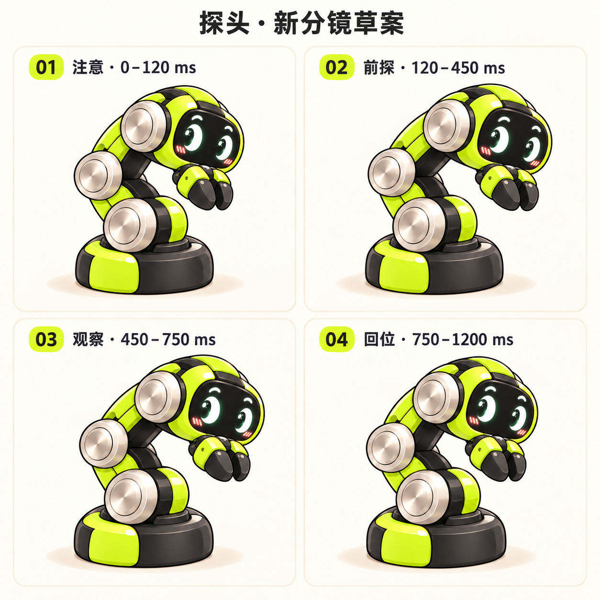

> 本文是早期完整动作分镜，保留用于后续逐帧制作。当前小幅抬头基准为 1600 ms，疑惑基准为 1400 ms；实机再乘风格系数和全局时长倍率 2 并有三个头顶问号；下文旧时长与分镜不代表当前运行版本。触发条件、睡眠恢复和输入范围以 [当前开发指南](../../docs/GETTING_STARTED.md) 为准。独立动画见 [GIF 文件夹](../../gifs/README.md)。

# reBuddy 屏幕动作分镜与节奏设计

**状态：待审阅设计；尚未制作完整连续动画，未替换固件资源。**

## 角色与画面

沿用资料包的 reBot RS 造型：荧光绿外壳、黑色面罩、银色圆关节、弯月高光与腮红，夹爪始终连接腕部。镜头、底座落点、比例固定；靠关节转动改变姿态，不通过拉伸角色、平移整图或整体缩放表现动作。

屏幕 320×240，角色区域 (80,40,160,160)，身体动画目标 15 FPS。下表是早期分镜时间，未包含当前全局时长倍率 2；活泼版乘 0.85，慵懒版乘 1.30，手势识别和冷却参数不变。阶段边界是设计时间，实际制作需映射到帧时间，并确认表情同步。所有像素和角度仅表示屏幕画面。

## 重新设计的探头

旧 probe-v2 保留作为历史参考；本轮允许重新设计。新方案强调「眼神先到 → 肘部打开 → 停留观察 → 连杆回位」，底座不滑动、夹爪不开合。

这是用于讨论动作意图的概念分镜；格间底座落点、比例和回位轮廓仍需统一，尚不能直接裁成连续动画。[来源与限制](../probe-v3/README.md)。其他七段以下方文字分镜和资料包原始图为准，尚未生成各自关键姿态。

## 全部动作概览

| 动作 | 基准 | 活泼 | 慵懒 | 结束姿态 |
| --- | ---: | ---: | ---: | --- |
| 探头看你 / PROBE | 1200 ms | 1020 ms | 1560 ms | IDLE |
| 贴近轻蹭 / NUZZLE | 1600 ms | 1360 ms | 2080 ms | IDLE |
| 疑惑歪头 / TILT | 1000 ms | 850 ms | 1300 ms | IDLE |
| 害羞缩回 / WITHDRAW | 900 ms | 765 ms | 1170 ms | FOLDED |
| 安抚展开 / RECOVER | 1600 ms | 1360 ms | 2080 ms | IDLE |
| 开心回应 / HAPPY | 2000 ms | 1700 ms | 2600 ms | IDLE |
| 困倦入睡 / REST | 3000 ms | 2550 ms | 3900 ms | REST |
| 迷糊醒来 / WAKE | 1600 ms | 1360 ms | 2080 ms | IDLE |

轻蹭表中 1600 ms 是进入 200 ms＋一轮 1000 ms＋退出 400 ms 的审阅示例。实际循环周期是 1000 ms；提前松手须从当前姿态退出，不等待示例播完。

## 逐段分镜

### 01 · 探头看你 / PROBE

先看见，再靠近

**触发：** 正常状态轻点角色，抬手确认；第三次连点改为退缩。

| 基准时间 | 分镜 | 身体 | 表情 | 夹爪 |
| --- | --- | --- | --- |
| 0–120 ms | 注意触点 | 身体先不动；肩、肘、腕保持待机角度。 | 视线朝触点，眉弧轻抬；保留原图弯月高光。 | 保持自然闭合 |
| 120–450 ms | 打开肘部 | 肘部打开，肩与腕配合；头和夹爪整体向触点前探，脸中心移动约 4–6 px。 | 眼睛略睁大，追随触点；不随身体拉伸。 | 保持自然闭合 |
| 450–750 ms | 停留观察 | 保持前探位置；不继续累加位移。 | 专注地看向触点，眉弧放松。 | 保持自然闭合 |
| 750–1200 ms | 柔和回位 | 肘部逐渐收回，腕部保持脸的朝向，终帧准确回到 IDLE。 | 视线从触点缓慢回中。 | 保持自然闭合 |

**衔接：** 普通请求只保留一个；抚摸在有匹配过渡的连接点接轻蹭，连戳优先接退缩。

**参考：** 互动图 01；本轮允许重新设计探头，probe-v2 仅作历史参考。 计划制作 10 张不同姿态，连接帧另计。

### 02 · 贴近轻蹭 / NUZZLE

顺着你的手，轻轻摇一摇

**触发：** 正常状态识别到有效慢抚摸；静止长按不触发。

| 基准时间 | 分镜 | 身体 | 表情 | 夹爪 |
| --- | --- | --- | --- |
| 0–200 ms | 放松靠近 | 上段轻靠向抚摸方向；底座不移动。 | 约 200 ms 内变为眯眼笑，保留三条腮红。 | 保持自然闭合 |
| 200–450 ms | 轻靠一侧 | 上段朝第一侧移动约 3–4 px，头部轻靠，腕部保持连接。 | 弯眼、放松。 | 保持自然闭合 |
| 450–700 ms | 经过中位 | 由连杆旋转回到中位，银色关节保持圆形。 | 保持笑眼。 | 保持自然闭合 |
| 700–950 ms | 轻靠另一侧 | 到另一侧约 3–4 px，不翻转整张图片；需要另一方向姿态。 | 保持笑眼。 | 保持自然闭合 |
| 950–1200 ms | 回中放松 | 完成一轮 1000 ms 轻摆；持续抚摸可再走一轮。 | 目光柔和，继续接受抚摸。 | 保持自然闭合 |
| 1200–1600 ms | 松手回位 | 此段为松手示例：从当前姿态用约 400 ms 回到 IDLE。 | 笑眼逐步恢复普通眼形。 | 保持自然闭合 |

**衔接：** 连续最多两轮，然后放松停留约 500 ms 再判断；松手或停动超过 250 ms 从当前姿态退出，不能等播放到示例末尾才松手。

**参考：** 互动图 02。 计划制作 12 张不同姿态，连接帧另计。

1600 ms 是「进入 + 一轮 + 退出」分镜示例；JSON 中 NUZZLE_CYCLE=1000 ms 仍指循环本身。

### 03 · 疑惑歪头 / TILT

你刚才是在逗我吗

**触发：** 正常状态识别到快速划动；同次接触只触发一次。

| 基准时间 | 分镜 | 身体 | 表情 | 夹爪 |
| --- | --- | --- | --- |
| 0–100 ms | 看向划动 | 保持当前连接姿态，停止轻蹭累积。 | 眼睛睁大，视线追向划动方向。 | 保持自然闭合 |
| 100–450 ms | 小幅倾头 | 头部绕腕部轻倾约 4–6°，上段轻微配合；底座保持水平。 | 一侧眉弧略高，视线朝触点。 | 保持自然闭合 |
| 450–650 ms | 疑惑停留 | 保持倾头角度，不继续加深。 | 保留原图的圆润好奇眼形。 | 保持自然闭合 |
| 650–1000 ms | 回正 | 腕部与连杆同步回到 IDLE。 | 眉弧、视线回中。 | 保持自然闭合 |

**衔接：** 横向位移决定方向；横向很小时固定一侧。新手势需先抬手，退缩请求优先。

**参考：** 角色图中的「好奇」姿态。 计划制作 10 张不同姿态，连接帧另计。

### 04 · 害羞缩回 / WITHDRAW

收起来，等你安抚

**触发：** 1200 ms 内第三次合格轻点，清空普通请求和点击历史。

| 基准时间 | 分镜 | 身体 | 表情 | 夹爪 |
| --- | --- | --- | --- |
| 0–120 ms | 惊讶一下 | 从当前姿态开始，身体不先跳回待机。 | 短促眨眼，随后睁眼。 | 保持自然闭合 |
| 120–650 ms | 收拢连杆 | 肘和腕向内折；头部向内下方约 6–10 px，夹爪收至脸前。 | 目光略躲开，眉弧收紧。 | 随腕部收近，保持闭合 |
| 650–900 ms | 保持收拢 | 停稳于 FOLDED，底座不后滑，整体不缩小。 | 略紧张但仍可爱；眼睛不变成尖角。 | 保持收近 |

**衔接：** 结束后持续保持 FOLDED；继续戳只眨眼或避视，不重复收缩。需合格安抚才能展开；也可从收拢进入睡眠。

**参考：** 互动图 03。 计划制作 10 张不同姿态，连接帧另计。

### 05 · 安抚展开 / RECOVER

先放松，再重新靠近

**触发：** 退缩状态累计 1200 ms 有效抚摸；暂停超过 500 ms 清零。

| 基准时间 | 分镜 | 身体 | 表情 | 夹爪 |
| --- | --- | --- | --- |
| 0–250 ms | 缓和眼神 | 身体仍保持 FOLDED，不抢先展开。 | 眉弧舒展，视线重新看向手指。 | 保持收近 |
| 250–1000 ms | 逐渐展开 | 肘部慢慢打开，头部随上段靠近，展开到待机高度。 | 眼睛逐渐明亮，保持原图高光。 | 保持自然闭合 |
| 1000–1300 ms | 轻蹭一下 | 接一小段侧靠，无夹爪开合。 | 短暂眯眼笑。 | 保持自然闭合 |
| 1300–1600 ms | 回中相处 | 轻摆回中，准确落在 IDLE。 | 恢复平静友好的目光。 | 保持自然闭合 |

**衔接：** 当前接触只用于安抚；完成后清空安抚与开心计时，必须松手再互动。恢复期间再轻点或快速划动，要经专门过渡回 FOLDED。

**参考：** 互动图 04。 计划制作 12 张不同姿态，连接帧另计。

### 06 · 开心回应 / HAPPY

被温柔对待后的一次小雀跃

**触发：** 正常状态轻柔抚摸手爪，累计约 600 ms 有效移动，且未被点击或快划打断。

| 基准时间 | 分镜 | 身体 | 表情 | 夹爪 |
| --- | --- | --- | --- |
| 0–200 ms | 先笑起来 | 身体保持自然连接，准备抬起。 | 弯眼笑，三条腮红更明显。 | 保持自然闭合 |
| 200–600 ms | 抬起上身 | 肩与肘展开，脸中心抬高约 4–6 px；底座始终贴地。 | 保持笑眼。 | 保持自然闭合 |
| 600–1000 ms | 向一侧轻摆 | 上段轻摆到第一侧，夹爪随腕部移动。 | 保持笑眼，不漂移。 | 缓慢打开一次 |
| 1000–1400 ms | 摆向另一侧 | 接另一侧轻摆并开始回中。 | 保持笑眼。 | 合回自然位置，完成一次开合 |
| 1400–2000 ms | 回到待机 | 上身缓慢落回原高度，连杆回中，不弹跳。 | 从笑眼自然恢复到友好目光。 | 保持自然闭合 |

**衔接：** 每段抚摸最多一次；完成或中断后都进入 15 秒冷却，另需连续松手至少 2 秒。松手可完成这一次，后续抚摸不重复开心。

**参考：** 互动图 05；角色图「开心」。 计划制作 12 张不同姿态，连接帧另计。

### 07 · 困倦入睡 / REST

先困，再趴下来

**触发：** 无有效互动达到 60 秒且未按住；普通动作结束后进入。

| 基准时间 | 分镜 | 身体 | 表情 | 夹爪 |
| --- | --- | --- | --- |
| 0–800 ms | 眼皮变沉 | 由当前稳定姿态进入；身体暂时保持。 | 眼皮缓缓下垂，不能突然切成闭眼。 | 保持自然闭合 |
| 800–2200 ms | 低头收拢 | 肩、肘、腕逐步折低，头靠近底座，夹爪放低。 | 目光缓慢向下，闭合程度随姿态加深。 | 随腕部放低，不夹合 |
| 2200–3000 ms | 闭眼停稳 | 落到 REST，轮廓明显低于待机，不把睡姿整体放大。 | 轻柔闭眼，保留原图弧形眼线。 | 保持放低 |

**衔接：** IDLE 和 FOLDED 分别需要入睡过渡；触摸立即取消入睡，从当前帧接 WAKE。稳定熟睡时身体不持续摇动。

**参考：** 互动图 06；角色图「困倦」。 计划制作 12 张不同姿态，连接帧另计。

### 08 · 迷糊醒来 / WAKE

醒来的这一下，只回应唤醒

**触发：** 休息或入睡过程中，角色区域内确认按下即触发，不等抬手。

| 基准时间 | 分镜 | 身体 | 表情 | 夹爪 |
| --- | --- | --- | --- |
| 0–250 ms | 迷糊睁眼 | 保持原来的睡姿或入睡中的当前姿态。 | 慢慢睁眼，先有表情反馈。 | 保持放低 |
| 250–1200 ms | 抬头展开 | 肩、肘、腕按连续顺序展开；接点必须匹配当前睡姿。 | 逐步睁开，视线靠向触点。 | 保持自然闭合 |
| 1200–1600 ms | 恢复关注 | 回到 IDLE，头与夹爪停稳。 | 视线回中，回到正常表情。 | 保持自然闭合 |

**衔接：** 消费整轮接触，直到松手都不再触发探头、轻蹭或开心；重复触摸不重启唤醒。

**参考：** 由困倦姿态连续展开；不能直接换成待机图。 计划制作 12 张不同姿态，连接帧另计。

## 稳定姿态

- **待机 / IDLE：** 底座固定，正常站高；轻眨眼、视线跟随；静止长按只关注。
- **收拢 / FOLDED：** 保持向内收拢，目光轻避开；再次戳不继续缩小或后移。
- **熟睡 / REST：** 身体折低、眼睛闭合、夹爪放低；从此姿态开始唤醒。

## 触摸识别与连续互动

当前操作与识别条件统一维护在 [开发指南](../../docs/GETTING_STARTED.md) 和 [行为配置](../../config/behavior_defaults.json)。开心通过轻柔摸爪触发，睡眠仅通过长按左下角唤醒；早期分镜的触发文字不作为运行规则。

## 连接与动画制作清单

- PROBE/NUZZLE/TILT/HAPPY 中途 → WITHDRAW：从当前轮廓收拢。
- NUZZLE 中途松手 → IDLE：从实际侧靠姿态退出，约 400 ms。
- RECOVER 被轻点/快划打断 → FOLDED：分阶段回收，避免首帧跳变。
- REST 中途 → WAKE：从当前闭眼程度和折叠程度展开。

上述连接均需真实匹配的姿态或单独过渡。阶段结束点可作为候选衔接位置，但不能因此延迟停止，也不能用任意两张静态图跳切。身体过渡制作前，表情可先回应；不能把这描述为完整动作已完成。

制作顺序：先确认探头四格的方向与角色一致性，再完成探头 8–12 张不同姿态及回位；随后制作待机/收拢/熟睡三姿态，轻蹭与歪头，退缩与安抚，开心，最后入睡与唤醒及中断连接。每段先核对轮廓和节奏，再导出 160×160 检查可读性。

身体使用预绘序列；眼睛使用干净面罩与逐帧锚点。复杂转头若烘焙表情，须隐藏叠加眼睛，避免双眼重影。8–12 张姿态与 15 FPS 并不等价：保持段可以重复帧，运动段必须有不同姿态。不得以整图形变补帧。最终资源数量、占用与播放性能以实际导出测量为准。

## 依据与边界

- 需求正文：[资料包说明提取](../../reference/documents/development_spec.txt)。
- 手势参数：[behavior_defaults.json](../../config/behavior_defaults.json)。
- 视觉依据：[角色原图](../../reference/character_reference.png)与[互动分镜](../../reference/interaction_storyboard.png)。
- 原 DOCX SHA256：`2c5b321b1d1becdac3c766340d49d1c18f8314e941e6c167d1e94923d33d5b41`。
- 此文档统一保存完整动作分镜，不维护重复的设计 JSON；运行参数以 `assets/config/` 为准。
