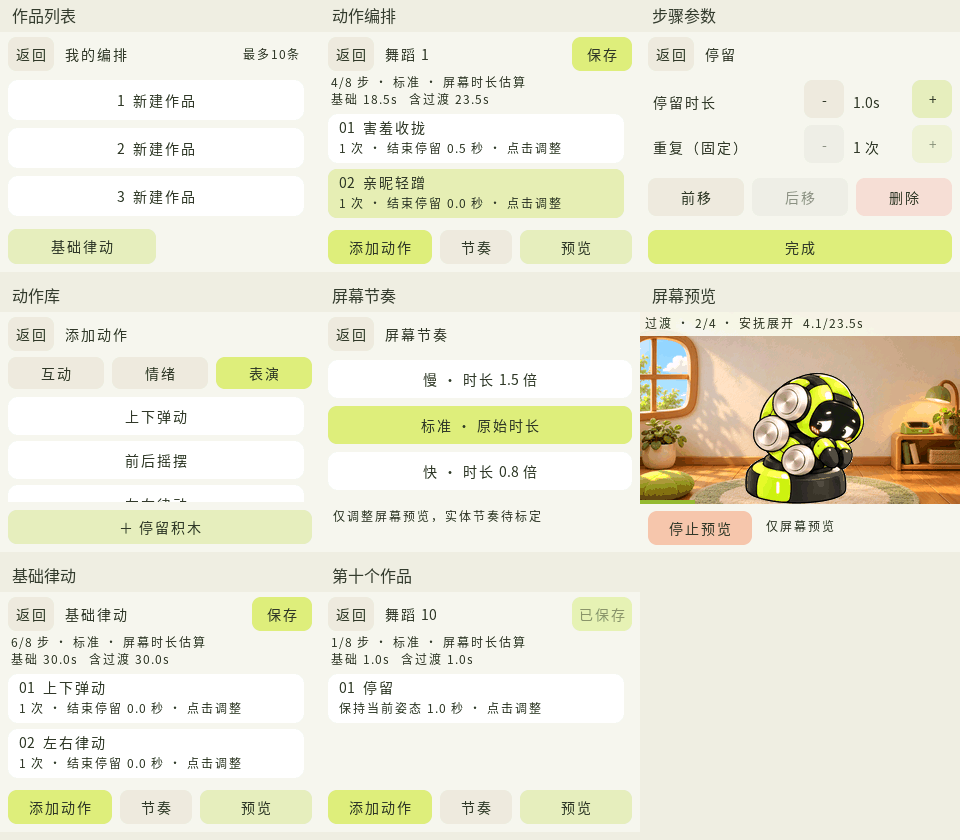

# 编舞编辑与屏幕预览

本版提供独立编舞编辑、屏幕预览和作品保存。实体机械臂联动尚未接入，“同步表演”保持禁用。

编舞页用于把已有动作排成一段表演，选择节奏、观看屏幕预览并保存。主画面继续保留小屋和直接触摸互动，动作卡片只出现在独立编辑页中。

日常 GIF 保持不变，舞蹈库替换为十个基本动作。每个作品最多 8 步，包含停留；最多保存 10 个作品。重复次数展开后不额外占用步骤。

舞蹈以标准 B601-RS 的六个机械臂关节和一个夹爪开合自由度为目标。左右夹爪按完整单元、两侧配合开合设计，随腕部组件转动，不独立挥手；具体原画表现仍需视觉验收。新一轮舞蹈素材使用完整角色姿态图集，每图集固定采样比例、整体平移到同一底盘落点，不添加运动缩放或分层部件拼接。图像生成原画的局部尺寸和运动质量仍待视觉验收，不能据此宣称严格刚体精度。详见 [动画视觉标准](ANIMATION_FIDELITY.md)。

## 进入与退出

从右下角设置中的“编排”进入作品列表，选择一个作品槽位新建或打开。作品名采用“舞蹈 1”等自动名称，不依赖屏幕中文输入法。

进入编舞时冻结日常动画和无操作计时，清除触摸及待执行请求。编辑、打开作品和屏幕预览均不会触发日常手势动作。退出后恢复进入时的日常状态并重新对齐计时；编辑期间经过的时间不会直接算作日常入睡或动作播放时间。原本正在休息的桌宠继续休息，不因返回主画面而自动唤醒。

有未保存修改时，返回需要选择保存、放弃修改或继续编辑。打开或保存作品都不会自动播放。

## 可用动作

| 动作 | 标准节奏基础时长 | 结束画面 |
| --- | --- | --- |
| 抬头看你 | 5 秒 | 正常待机姿态 |
| 亲昵轻蹭 | 6 秒 | 正常待机姿态 |
| 疑惑歪头 | 5 秒 | 正常待机姿态 |
| 害羞收拢 | 3 秒 | 保持收拢 |
| 安抚展开 | 5 秒 | 正常待机姿态 |
| 开心回应 | 8 秒 | 正常待机姿态 |
| [上下弹动](../gifs/dance/01_上下弹动.gif) | 3 秒 | 正常待机姿态 |
| [前后摇摆](../gifs/dance/02_前后摇摆.gif) | 3 秒 | 正常待机姿态 |
| [左右律动](../gifs/dance/03_左右律动.gif) | 3 秒 | 正常待机姿态 |
| [斜向指拍](../gifs/dance/04_斜向指拍.gif) | 6 秒 | 正常待机姿态 |
| [关节波浪](../gifs/dance/05_关节波浪.gif) | 6 秒 | 正常待机姿态 |
| [环绕滚动](../gifs/dance/06_环绕滚动.gif) | 6 秒 | 正常待机姿态 |
| [腕部隔离](../gifs/dance/07_腕部隔离.gif) | 3 秒 | 正常待机姿态 |
| [几何折线](../gifs/dance/08_几何折线.gif) | 6 秒 | 正常待机姿态 |
| [重拍弹点](../gifs/dance/09_重拍弹点.gif) | 3 秒 | 正常待机姿态 |
| [移动定格](../gifs/dance/10_移动定格.gif) | 6 秒 | 正常待机姿态 |
| 停留 | 由步骤参数指定 | 保持上一段结束画面 |

共十六种动作：六种日常互动动作和十种基本舞蹈动作，另有停留积木。舞蹈的动作含义与拍数见 [舞蹈清单](../gifs/dance/README.md)。入睡、熟睡和唤醒继续由日常行为管理，不加入可任意排列的动作库。

## 编辑作品

1. 在步骤列表中选中一个动作，再打开动作库添加；新动作插在选中项之后。没有选中项时追加到末尾。
2. 选中步骤后前移、后移或删除。首项不能前移，末项不能后移；满 8 步后不能继续添加。
3. 动作结束后可增加 0～3 秒停留，以 0.5 秒调整；“停留”积木的时长为 0.5～3 秒，也以 0.5 秒调整并占一步。十种基本舞蹈动作可重复 1～3 次；六种日常动作和停留固定一次。
4. 选择整段的慢、标准或快节奏，查看预览时长，再进入屏幕预览。空作品不能播放。
5. 保存到当前作品槽位。替换已有作品需要明确确认，不影响其他作品槽位。

## 节奏与动作衔接

屏幕预览使用慢 1.5 倍、标准 1.0 倍、快 0.8 倍的时长倍率。动作、动作后的停留、停留积木和自动过渡都按同一倍率计算；步骤参数中的秒数是标准节奏时长。标准档保留原有平均 8 FPS 时间轴；其他档位改变播放时间，不修改 GIF 文件、角色比例或画面尺寸。

编排时检查动作入口和出口姿态。例如，正常姿态接“安抚展开”前需要先收拢；收拢后接“开心回应”等正常姿态动作前需要先展开。播放器使用已有“害羞收拢”和“安抚展开”动画补充视觉过渡，过渡段纳入总时长，不占用户的 8 个步骤名额。

界面区分步骤基础时长和包含过渡的屏幕预览总时长。这些数字描述本版动画播放，不是经过机械臂标定的执行时长。实际屏幕刷新还受设备调度和负载影响。

## 屏幕预览

点击编辑页“预览”，再选择“屏幕预览”。顶部显示当前步骤、动作或过渡、已播时间与总时长；下方始终保留“停止预览”。

停止后保持当前帧，不自动回中或继续下一步。可以返回编辑，或明确点击“重播”从头开始。正常播放结束也保持最后画面，不循环重播。若作品以收拢结束，就保持收拢画面；不会为了回中额外追加未显示的动作。

作品列表保留既有可编辑示例“基础律动”。本轮先验收十个独立动作，未新增组合作品；下表仅说明已有程序功能：

| 步骤 | 内容 | 标准节奏时段 |
| --- | --- | --- |
| 1 | 上下弹动 ×1 | 0～3 秒 |
| 2 | 左右律动 ×1 | 3～6 秒 |
| 3 | 斜向指拍 ×1 | 6～12 秒 |
| 4 | 关节波浪 ×1 | 12～18 秒 |
| 5 | 环绕滚动 ×1 | 18～24 秒 |
| 6 | 移动定格 ×1 | 24～30 秒 |

共 6 个步骤，标准节奏总长 30 秒；慢节奏 45 秒，快节奏 24 秒。点击示例会使用首个空槽位创建，仍需手动保存；十个槽位均占用时，先选择已有作品并确认重建，不会自动覆盖。

请逐段查看 [十个独立基本动作](../gifs/dance/README.md)。本轮不生成组合 GIF，先确认每个动作的可辨识度、局部尺寸与衔接，再考虑完整舞蹈。新一轮素材尚未完成视觉验收或硬件验证，GIF 文件更新不代表当前固件已同步。

标准屏幕节奏为 80 BPM，3 秒对应 4 拍、6 秒对应 8 拍。当前完整角色姿态动画表达的是经用户确认的舞蹈概念，并未完成 B601-RS 的逆解、完整轨迹限位、碰撞、速度和动态精度验证。接入电机前需要围绕实机中间姿态重新标定与低速验证，不直接使用 GIF 的像素位移作为轨迹。重拍弹点通过短行程表达，移动定格必须经规划减速，均不以电机冲击或急停来制造效果。

## 动作设计依据

- [B601-RS 官方控制资料](https://wiki.seeedstudio.com/cn/rebot_arm_b601_rs_mit_control/)：标准六关节机械臂及夹爪结构。
- [B601-RS ROS 2 集成资料](https://wiki.seeedstudio.com/cn/rebot_arm_b601_rs_ros2_integration/)：后续机械臂模型与运动规划接入参考。
- [Groove 教学资料](https://www.carpenterarts.org/sites/cpac/files/document/vs_generalpd_studyguide.pdf)、[Popping 基础训练](https://www.steezy.co/posts/how-to-learn-popping)、[Popping 技巧说明](https://www.steezy.co/posts/what-is-popping-dance)及[舞蹈指向教学](https://downloads.bbc.co.uk/schoolradio/pdfs/danceworkshop_spring_2013.pdf)：律动、隔离、波浪、弹点、定格与指向的概念参考。

上述舞蹈术语用于单机械臂改编，并不表示机械臂能原样复现人体关节、双臂或步法。

## 保存与恢复

十个作品槽位存放在设备 NVS 中。六种日常动作及停留的标识保持不变；新舞蹈使用 ID 23～32。旧表演 ID 9～14、16～22 已停用并保留编号，不再复用。包含这些旧动作的作品会提示无法读取，需要用户手动重建；不会将旧动作自动映射到新动作，也不会自动覆盖原记录。保存只由用户操作触发，添加步骤、调整参数或预览时不会持续写 Flash。断电后可重新打开已经保存的作品；重启或加载作品不会自动续播。

每个槽位保留两份带版本、序号与校验的记录。保存时写较旧的一份；写入失败或写入中断时，原来的有效记录保留。读取时优先选择最新有效记录，新记录损坏时可退回另一份有效记录。两份记录均不可用时报告错误，不静默替换动作或自动清空整个 NVS。发现不兼容版本时拒绝读取和覆盖，不自动迁移或回退到旧版本作品，避免旧固件覆盖新版本数据。

## 本版边界

- 可编辑和预览十六种动作与停留。
- 本版不发送 CAN 控制命令。同步表演保持不可用，进入、保存、加载或播放屏幕预览都不会启动电机。
- 屏幕预览的节奏倍率不能直接当作实体动作速度。接入机械臂后还需要轨迹、入口姿态、速度范围及停止链路标定，双方再使用共同的阶段时间轴。
- 偶发张望和身体调整尚未新增；日常触摸规则和入睡流程沿用当前实现。
- 软件验证不能代替真实开发板的连续 30 分钟交互、显示性能和未来机械臂同步验收。

构建与烧录见 [开发指南](GETTING_STARTED.md)，当前视觉资源见 [GIF 说明](../gifs/daily/README.md)。
